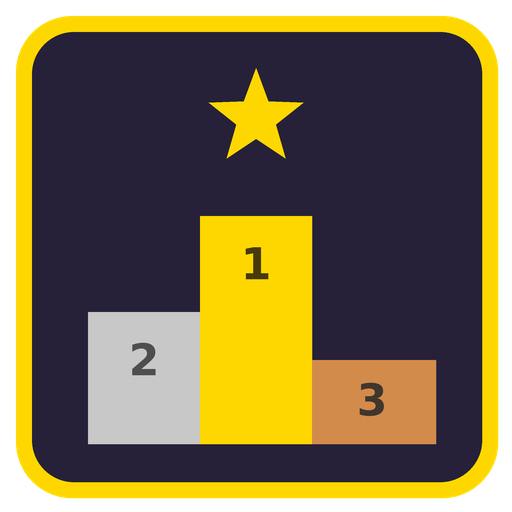

<p align="center"></p>

<h1 align="center">Best in Pack</h1>

<p align="center"><b>Which food, armor, weapon, tool and fuel is the best in your modpack?</b><br>
Press <b>B</b> and see every item from every mod, ranked.</p>

<p align="center">
<a href="https://www.curseforge.com/minecraft/mc-mods/best-in-pack">Download on CurseForge</a> ·
<a href="../../issues/new/choose">Report a bug or suggest an idea</a> ·
<a href="CHANGELOG.md">Changelog</a>
</p>

Big modpacks add hundreds of swords, chestplates, foods and fuels – and nothing tells you which one is actually
better. Best in Pack reads the real stats of every item in your game and puts them in sortable tables.

## Features

- **Four tabs** – Food, Armor, Weapons & Tools, Fuel – with every item from every mod, sorted by what matters
  (DPS, armor and toughness, hunger and saturation, burn time…). Click any column to sort by it.
- **Search** by name, `@mod` to show one mod, `-word` to leave things out.
- **Details** shows every stat, including special bonuses like flight or damage immunity.
- **Shift tooltip rank** – hold Shift over any item: *Best in Pack: #2 of 14 weapons (by DPS)*.
- **Jump to an item** – hover an item in your inventory, JEI or REI and press B to open its row.
- **JEI and REI** – click a row to see how to craft it.
- **Client-only** – works on any server, nothing to install there.
- **Fabric, Forge and NeoForge**, every Minecraft version from **1.21 to 26.3**.

## Which file do I need?

| Minecraft | Fabric | Forge | NeoForge |
|---|---|---|---|
| 1.21, 1.21.1 | `fabric-1.21-1.21.1` | `forge-1.21-1.21.1` | `neoforge-1.21-1.21.1` |
| 1.21.2 – 1.21.4 | `fabric-1.21.2-1.21.4` | `forge-1.21.2-1.21.4` ¹ | `neoforge-1.21.2-1.21.4` |
| 1.21.5 | `fabric-1.21.5` | `forge-1.21.5` | `neoforge-1.21.5` |
| 1.21.6 – 1.21.8 | `fabric-1.21.6-1.21.8` | `forge-1.21.6-1.21.8` | `neoforge-1.21.6-1.21.8` |
| 1.21.9, 1.21.10 | `fabric-1.21.9-1.21.10` | `forge-1.21.9-1.21.10` | `neoforge-1.21.9-1.21.10` |
| 1.21.11 | `fabric-1.21.11` | `forge-1.21.11` | `neoforge-1.21.11` |
| 26.1 – 26.1.2 | `fabric-26.1-26.1.2` | `forge-26.1-26.1.2` | `neoforge-26.1-26.1.2` |
| 26.2 | `fabric-26.2` | `forge-26.2` | `neoforge-26.2` |
| 26.3 | `fabric-26.3` | `forge-26.3` | `neoforge-26.3` |

¹ Forge was never released for 1.21.2, so this file covers 1.21.3 and 1.21.4.
Fabric needs Fabric API. JEI and REI are optional.

## Settings and modpacks

Everything lives in `config/bestinpack/` – `bestinpack.json` is explained in the `README.txt` next to it.

- **Different default key for your modpack:** `"openKey": "N"` (also `"F6"`, `"left alt"`, `"none"`). It is used
  by new installs and by "Reset" in Controls; players can still change their key in Minecraft's Controls.
- `welcomeMessage` / `keyConflictWarning` switch off the two chat messages.
- `hiddenMods` / `hiddenItems` leave things out of the rankings; items hidden in JEI/REI are left out too.
- Only items that are in the creative inventory are ranked (like JEI); `onlyCreativeItems: false` ranks everything.

## Bugs and ideas

Please use the [issue tracker](../../issues/new/choose) – there are short forms for bug reports and for ideas.
For a crash, attach `logs/latest.log` or the crash report; for a wrong ranking, name the item and the modpack.

## Building from source

One source tree serves every loader and version. Version differences are marked in the code with
`//#if MC >= 1.21.5` … `//#endif` lines, and `tools/gen.py` writes a normal Gradle project per loader and
version range into `builds/`:

```bash
python3 tools/gen.py neoforge 1.21-1.21.1     # loader: fabric | forge | neoforge, era: see tools/targets.py
cd builds/neoforge-1.21-1.21.1 && gradle build
# or everything at once (GRADLE / GRADLE_FABRIC / JAVA21_HOME / JAVA25_HOME can be set):
tools/buildall.sh neoforge
```

Requirements: Python 3, JDK 21 (and JDK 25 for 26.x), Gradle 9.5+ (Fabric: Gradle 9.8+ running on JDK 25).
`tools/smoke.sh` runs the automatic in-game test used before every release.

## License

[MIT](LICENSE) © Pokato
