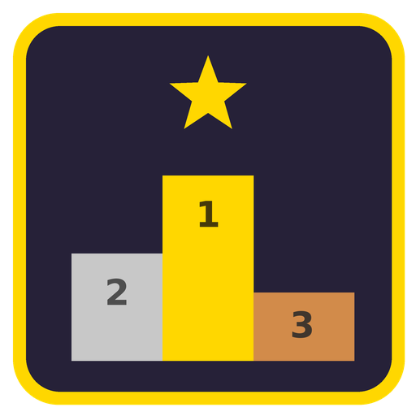
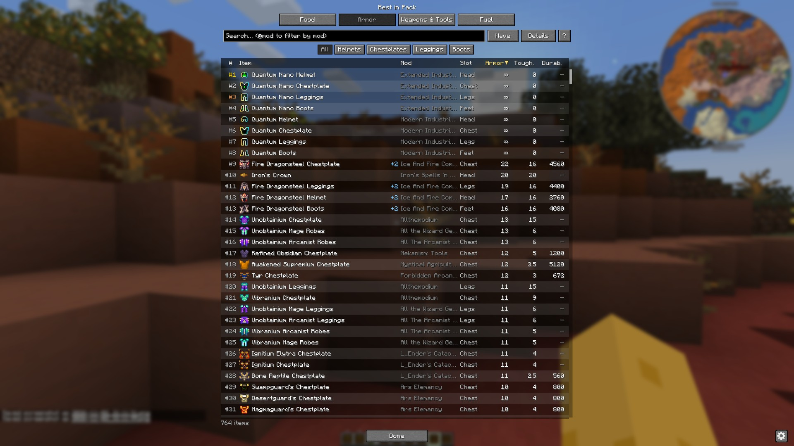
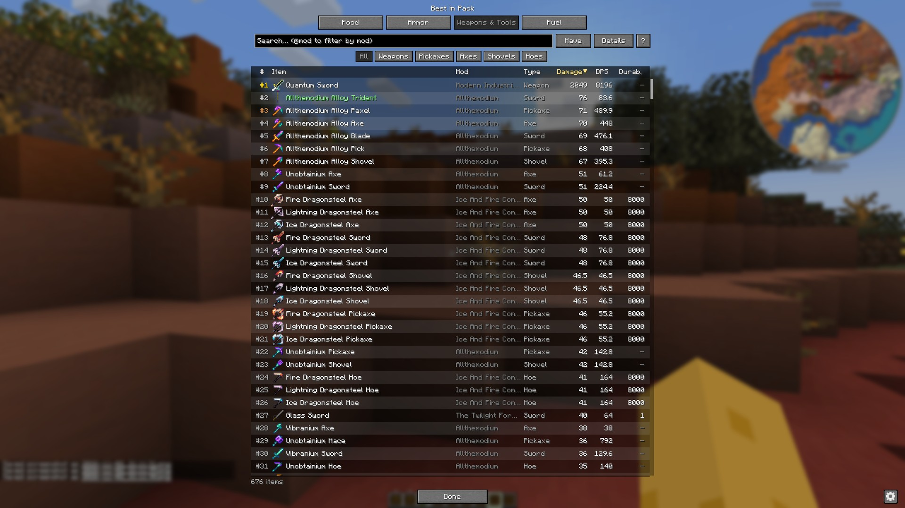
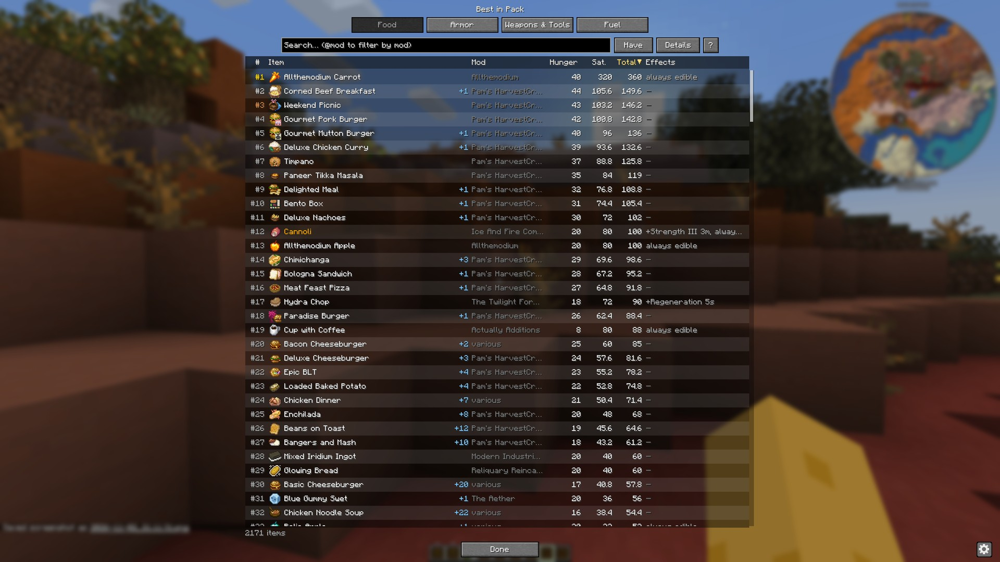
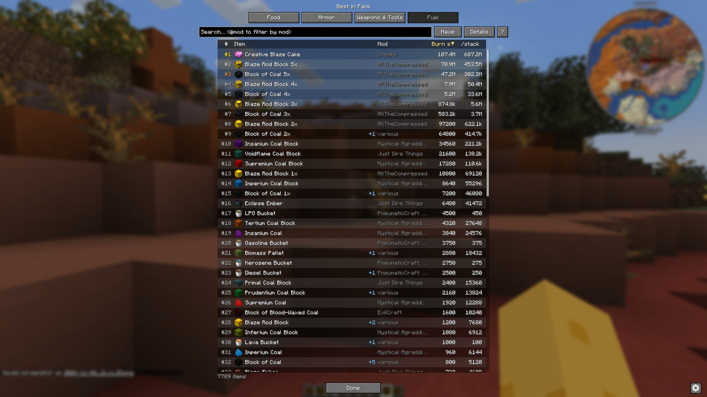
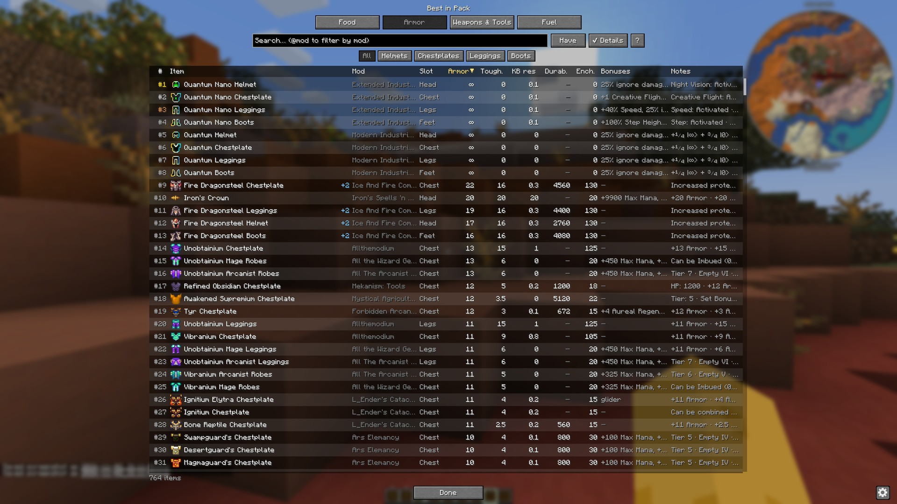
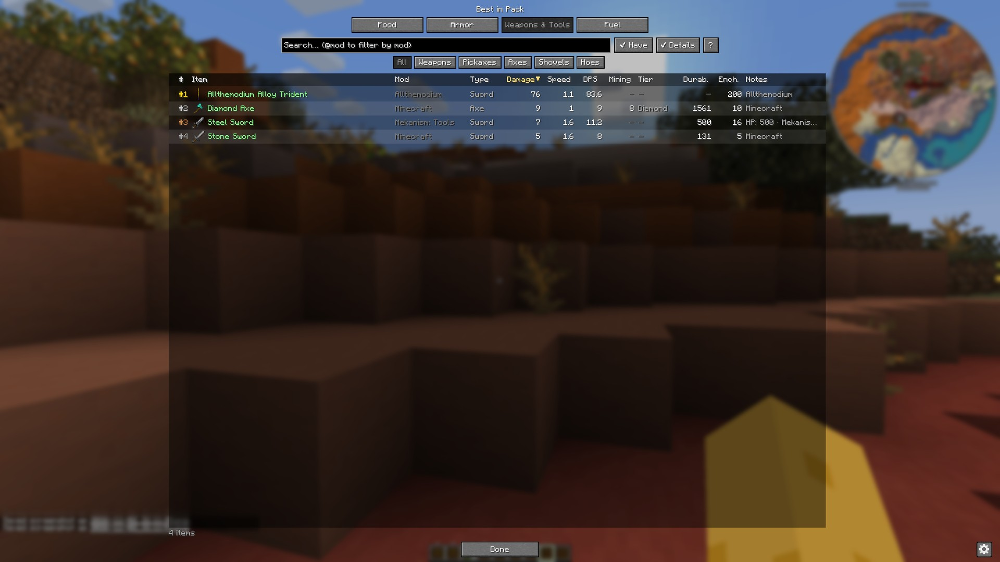
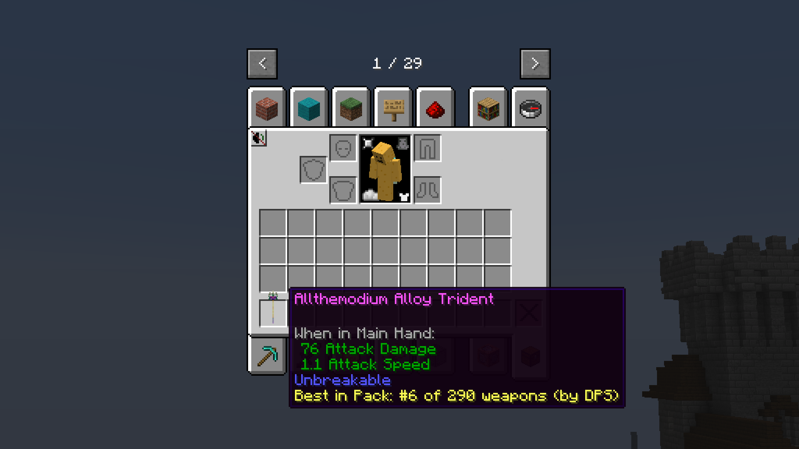

<p align="center"></p>

<h1 align="center">Best in Pack</h1>

<p align="center"><b>Which food, armor, weapon, tool and fuel is the best in your modpack?</b><br>
Press <b>B</b> and see every item from every mod, ranked.</p>

<p align="center">
<a href="https://www.curseforge.com/minecraft/mc-mods/best-in-pack">Download on CurseForge</a> ·
<a href="../../issues/new/choose">Report a bug or suggest an idea</a> ·
<a href="CHANGELOG.md">Changelog</a>
</p>

Big modpacks add hundreds of swords, chestplates, foods and fuels – and nothing tells you which one is actually
better. Best in Pack reads the real stats of every item in your game and puts them in sortable tables.



## Features

- **Four tabs** – Food, Armor, Weapons & Tools, Fuel – with every item from every mod, sorted by what matters
  (DPS, armor and toughness, hunger and saturation, burn time…). Click any column to sort by it.
- **Search** by name, `@mod` to show one mod, `-word` to leave things out.
- **Details** shows every stat, including special bonuses like flight or damage immunity.
- **Have** shows only the items in your inventory – items you have are green in every list.
- **Shift tooltip rank** – hold Shift over any item: *Best in Pack: #2 of 14 weapons (by DPS)*.
- **Jump to an item** – hover an item in your inventory, JEI, REI or EMI and press B to open its row.
- **JEI, REI and EMI** – click a row to see how to craft it, right-click to see what it is used for.
- **Client-only** – works on any server, nothing to install there.
- **Fabric, Forge and NeoForge**, every Minecraft version from **1.18 to 26.3**.

## Screenshots

*All the Mods 10 (NeoForge 1.21.1)*

| | |
|---|---|
|  |  |
|  |  |
|  |  |

## Which file do I need?

| Minecraft | Fabric | Forge | NeoForge |
|---|---|---|---|
| 1.18, 1.18.1 | `fabric-1.18-1.18.1` | `forge-1.18-1.18.1` | – ⁴ |
| 1.18.2 | `fabric-1.18.2` | `forge-1.18.2` ⁵ | – |
| 1.19 – 1.19.2 | `fabric-1.19-1.19.2` | `forge-1.19-1.19.2` ⁵ | – |
| 1.19.3 | `fabric-1.19.3` | `forge-1.19.3` | – |
| 1.19.4 | `fabric-1.19.4` | `forge-1.19.4` | – |
| 1.20, 1.20.1 | `fabric-1.20-1.20.1` | `forge-1.20-1.20.1` | `forge-1.20-1.20.1` ² |
| 1.20.2 | `fabric-1.20.2` | `forge-1.20.2` | `neoforge-1.20.2` |
| 1.20.3, 1.20.4 | `fabric-1.20.3-1.20.4` | `forge-1.20.3-1.20.4` | `neoforge-1.20.3-1.20.4` |
| 1.20.5, 1.20.6 | `fabric-1.20.5-1.20.6` | `forge-1.20.5-1.20.6` ³ | `neoforge-1.20.5-1.20.6` |
| 1.21, 1.21.1 | `fabric-1.21-1.21.1` | `forge-1.21-1.21.1` | `neoforge-1.21-1.21.1` |
| 1.21.2 – 1.21.4 | `fabric-1.21.2-1.21.4` | `forge-1.21.2-1.21.4` ¹ | `neoforge-1.21.2-1.21.4` |
| 1.21.5 | `fabric-1.21.5` | `forge-1.21.5` | `neoforge-1.21.5` |
| 1.21.6 – 1.21.8 | `fabric-1.21.6-1.21.8` | `forge-1.21.6-1.21.8` | `neoforge-1.21.6-1.21.8` |
| 1.21.9, 1.21.10 | `fabric-1.21.9-1.21.10` | `forge-1.21.9-1.21.10` | `neoforge-1.21.9-1.21.10` |
| 1.21.11 | `fabric-1.21.11` | `forge-1.21.11` | `neoforge-1.21.11` |
| 26.1 – 26.1.2 | `fabric-26.1-26.1.2` | `forge-26.1-26.1.2` | `neoforge-26.1-26.1.2` |
| 26.2 | `fabric-26.2` | `forge-26.2` | `neoforge-26.2` |
| 26.3 | `fabric-26.3` | `forge-26.3` | `neoforge-26.3` |

¹ Forge was never released for 1.21.2, so this file covers 1.21.3 and 1.21.4.
² NeoForge for 1.20.1 is a fork of Forge 47 and runs the Forge file.
³ Forge was never released for 1.20.5, so this file covers 1.20.6.
⁴ NeoForge did not exist before 1.20.1.
⁵ Needs Forge 40.0.47 or newer on 1.18.2 and Forge 41.0.94 or newer on 1.19 (any Forge on the other versions).
Fabric needs Fabric API. JEI, REI and EMI are optional. Before 1.20 not every viewer exists everywhere: Fabric 1.18
and 1.18.1 only have REI, and EMI starts with 1.18.2 on Fabric and 1.19.2 on Forge.

## Settings and modpacks

Everything lives in `config/bestinpack/` – `bestinpack.json` is explained in the `README.txt` next to it.

- **Different default key for your modpack:** `"openKey": "N"` (also `"F6"`, `"left alt"`, `"none"`). It is used
  by new installs and by "Reset" in Controls; players can still change their key in Minecraft's Controls.
- `welcomeMessage` / `keyConflictWarning` switch off the two chat messages.
- `hiddenMods` / `hiddenItems` leave things out of the rankings; items hidden in JEI, REI or EMI are left out too.
- Only items that are in the creative inventory are ranked (like JEI); `onlyCreativeItems: false` ranks everything.

## Bugs and ideas

Please use the [issue tracker](../../issues/new/choose) – there are short forms for bug reports and for ideas.
For a crash, attach `logs/latest.log` or the crash report; for a wrong ranking, name the item and the modpack.

## Building from source

One source tree serves every loader and version. Version differences are marked in the code with
`//#if MC >= 1.21.5` … `//#endif` lines, and `tools/gen.py` writes a normal Gradle project per loader and
version range into `builds/`:

```bash
python3 tools/gen.py neoforge 1.21-1.21.1     # loader: fabric | forge | neoforge, era: see tools/targets.py
cd builds/neoforge-1.21-1.21.1 && gradle build
# or everything at once (GRADLE / GRADLE_FABRIC / JAVA21_HOME / JAVA25_HOME can be set):
tools/buildall.sh neoforge
```

Requirements: Python 3, JDK 21 (plus JDK 17 for 1.18–1.20.4 and JDK 25 for 26.x), Gradle 9.5+ (Fabric: Gradle 9.8+
running on JDK 25; Forge 1.18–1.20.4 and NeoForge 1.20.2: Gradle 8.14, set as `GRADLE8`).
`tools/smoke.sh` runs the automatic in-game test used before every release, `tools/jarcheck.py` checks the finished
JARs and `tools/prodcheck.sh` starts one in a real Fabric, Forge or NeoForge install. The self-test class is left
out of the release JARs.

## How a release is tested

- Every reference the JARs make to Minecraft and the loader is resolved against each game version they cover
  (`tools/verifyall.sh`, 68 loader/version combinations).
- Every build runs the automatic in-game test on the newest version of its range (`tools/smokeall.sh`, 38 builds):
  chat messages, the key, every tab, search, sorting, Details, B over an inventory item, the tooltip rank.
- The click on a row that opens the recipe is tested with each recipe viewer:
  - **JEI** in the 28 builds for which a JEI release exists for that loader and game version (the other 10 run
    without a recipe viewer). Forge 1.20 – 1.20.4 cannot load JEI in a development run, so those three are tested
    in a real install (`tools/prodself.sh`).
  - **EMI** in all ten builds that carry the EMI bridge (`tools/smokeemi.sh`; Forge 1.20.1 and 1.20.2 in a real
    install), next to JEI on Fabric 1.20.1 and NeoForge 1.21.1, and with the oldest EMI of a range in real
    installs: EMI 1.0.3 on Fabric and Forge 1.20, EMI 1.1.12 on Fabric and NeoForge 1.21, and the Forge file on
    NeoForge 1.20.1.
  - **REI** in separate runs on Fabric 1.20.1, 1.21.11 and 26.3 and NeoForge 1.20.4, 1.21.1 and 26.3
    (`tools/smokerei.sh`).
- Every release JAR is started in a real Fabric, Forge or NeoForge install of every game version it covers
  (`tools/prodall.sh`, 69 combinations, including the Forge 1.20–1.20.1 JAR on NeoForge 1.20.1).
- Fabric up to 1.21.11 and Forge up to 1.20.4 run remapped JARs: for 0.9.5 the whole in-game test also ran in real
  installs of Fabric 1.20, 1.21 and 1.21.11 and Forge 1.20, 1.20.1, 1.20.2 and 1.20.4 (`tools/prodself.sh`).
- `tools/jarcheck.py` checks version, Java level and that no test code is in any release JAR.

For **0.9.6** all 48 files were rebuilt, and the whole in-game test – now with the creative inventory search and
typing B into the search boxes – ran in a real install of every loader and game version (`tools/prodself.sh`,
85 installs: 55 with JEI, the rest have no JEI release that loads there), plus 9 more runs with EMI and REI.

The ten files for **1.18 – 1.19.4** (added to 0.9.5 later, the 38 files above were not rebuilt) went through the same
steps, and more of them in real installs, because recipe viewers changed a lot in those years:

- References resolved for all 16 loader/version combinations, and against Forge's whole build list to find the
  oldest Forge with everything (`tools/forgemin.py`).
- The automatic in-game test in a development run for all ten builds.
- The whole in-game test in **55 real installs** (`tools/prodself.sh`): every game version on both loaders with
  every recipe viewer that exists for it –
  - **JEI** in 20 runs: 9.0, 9.1, 9.4, 9.5, 9.7, 10.2, 11.0, 11.1, 11.2, 11.68, 12.4 and 13.1 (the bridge for
    these versions finds JEI's functions by name; its lookups were also checked against 139 JEI releases),
  - **REI** 7, 8, 9, 10 and 11 in 11 runs, **EMI** 0.4.3, 0.7.3, 1.1.22 and 1.1.24 in 11 runs (two of them next
    to JEI),
  - the oldest Forge each file accepts (38.0.2, 39.0.0, 40.0.47, 41.0.94, 42.0.0, 43.0.0, 44.0.0, 45.0.0) and
    Fabric with the loader and Fabric API of the time (loader 0.12.12 on 1.18, 0.13.3 on 1.18.2, 0.14.9 on 1.19.2).
- Every release JAR started in a real install of every game version it covers (`tools/prodall.sh`, 16 more
  combinations).

Known for these versions: Forge 38.0.0 and 38.0.1 (the first two builds for 1.18) cannot start or create a world by
themselves. JEI 9.0 – 9.3 cannot tell what is hidden, and JEI before 11.5 does not report hiding while you play (it
counts from the next join). EMI before 1.0 (Fabric 1.18.2, 1.19, 1.19.1) cannot hide items; EMI 0.4 opens its recipe
screen over the inventory, so closing it returns there instead of to Best in Pack.

Known: JEI for Forge 1.20.2 only starts when the first inventory screen opens (its own log says so). Until then a
click on a row answers "The recipe viewer is still loading"; after that it opens the recipe as everywhere else.

## License

[MIT](LICENSE) © Pokato
